<p align="center">
  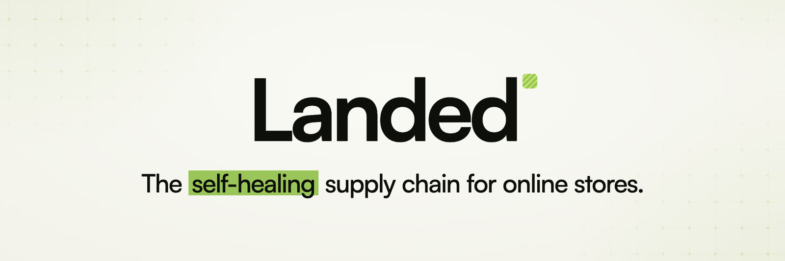
</p>

<p align="center">
  <b>When a factory runs late, Landed works out the best fix, and with one click it re-plans the shipment, pays the supplier and tells your customers.</b>
</p>

<p align="center">
  <a href="https://landed-ilff.onrender.com"><b>Try it live</b></a> ·
  <a href="#how-it-works">How it works</a> ·
  <a href="#features">Features</a> ·
  <a href="#the-ai-agents">The AI agents</a> ·
  <a href="#architecture">Architecture</a> ·
  <a href="#run-it-locally">Run it locally</a>
</p>

---

## The problem

Small online brands sell products that are made overseas. Every product they sell depends on a chain of steps: the factory, a quality check, the supplier payment, ocean freight, customs, the warehouse, and finally the customer.

When one step slips, everything after it moves too. Today nobody re-plans the chain. The owner finds out late, works it out on a spreadsheet, and the customer finds out last.

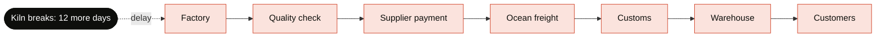

What that costs a small brand:

- **Missed sales.** Out-of-stocks cost retailers about $1.2 trillion a year, and a delay before Black Friday can wipe out the best weeks of the year.
- **Broken promises.** Customers who pre-ordered don't hear anything, then file "item not received" disputes.
- **Money paid too early.** The balance often goes to the factory before anyone has checked the goods.
- **Legal risk.** The FTC Mail Order Rule requires a delay notice and a free cancel option. Most small shops don't send one.

## What Landed does

Landed watches the whole chain for you. When something goes wrong, it does the planning work and shows you the answer in plain English.

| | |
|---|---|
| **Plans every order** | Each purchase order becomes a live timeline: production, inspection, payments, freight, customs and delivery, all linked. |
| **Fixes delays** | When a supplier reports a delay, an AI agent tests every option (wait, pay for overtime, air-freight part of the order, or a mix) and recommends the cheapest one that keeps your promises. |
| **Pays for good goods only** | The factory uploads photos of the finished batch. AI checks them against the approved sample. The balance is released through PayPal only if they pass. |
| **Keeps customers in the loop** | Affected customers get an honest delay notice with a new date, and can keep their order or get a full refund in one click. |
| **Stays in your control** | Nothing changes until you approve. One click runs the whole plan. |

## How it works

Here is what happens when a factory reports a delay.

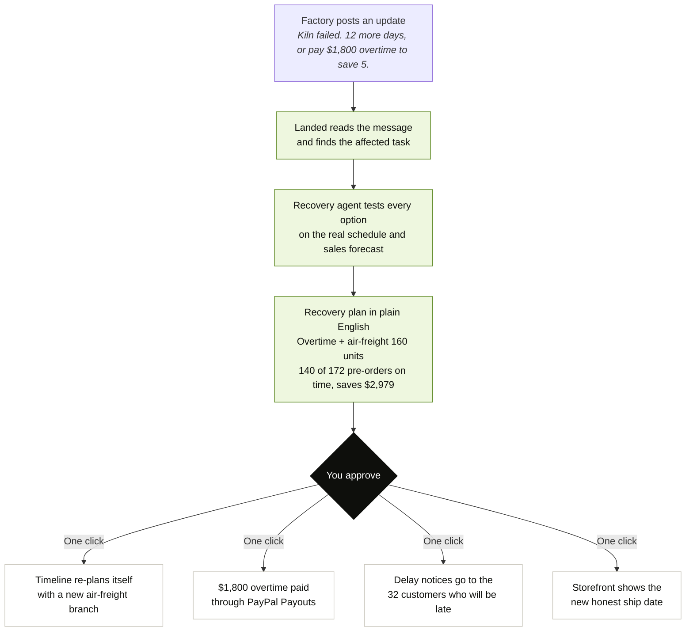

The same idea runs through the whole product. AI does the reading and the planning, plain code does the maths and the money, and you make the call.

## Features

### Command center
Every order, shipment and payment in one place, with a live sales forecast that shows pre-orders, sales and the sales you would lose to a stock-out.

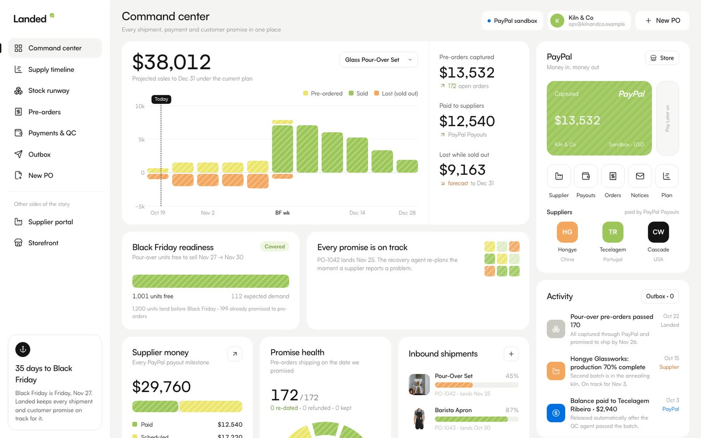

### Supply timeline, built on Bryntum Gantt
Every purchase order is a live Gantt chart. Each step is a linked task, supplier payments are milestones on the same chart, and the critical path shows exactly what stands between you and your promise date. Drag a bar and everything downstream moves with it.

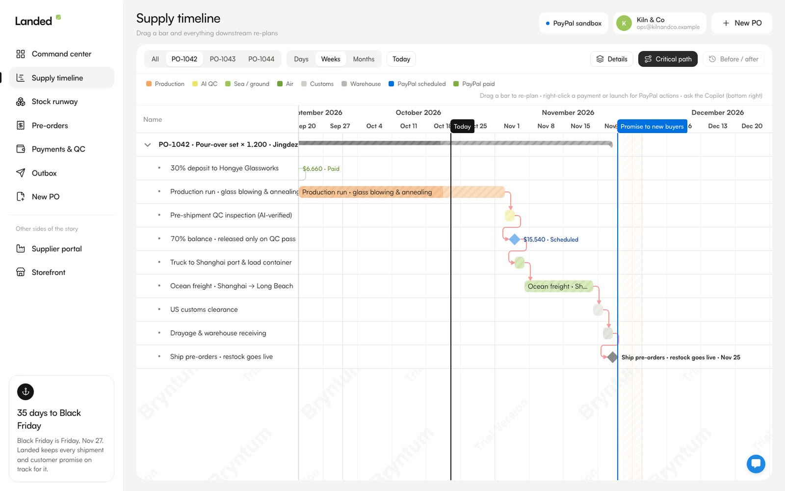

### Recovery plans
The agent compares every option side by side: first ship date, late pre-orders, lost sales, refunds, extra cost and total impact. The plan explains itself and waits for your approval.

<table>
  <tr>
    <td width="50%">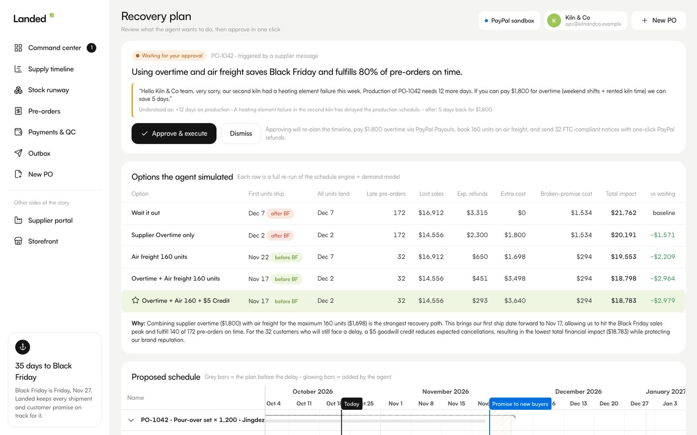</td>
    <td width="50%">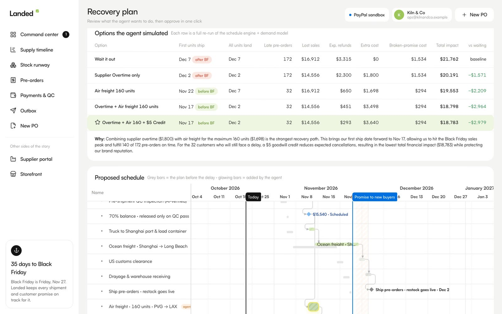</td>
  </tr>
  <tr>
    <td>The plan, the numbers and one Approve button.</td>
    <td>Every option the agent simulated, with the winner highlighted.</td>
  </tr>
</table>

### Automatic re-planning
After you approve, Bryntum re-schedules every dependent task. The old plan stays visible in grey, and the agent's new air-freight branch gets 160 units out before Black Friday.

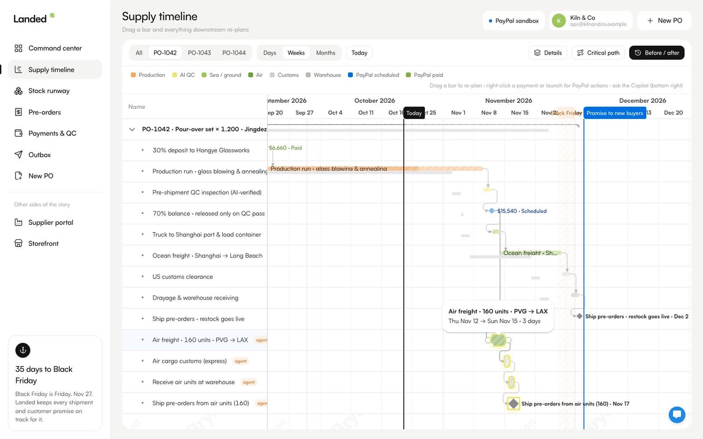

### Payments that wait for quality
Suppliers upload batch photos in their own portal. AI vision checks them against the approved sample and the spec. A bad batch keeps the money on hold and tells the factory exactly what is wrong. A good batch releases the balance through PayPal Payouts.

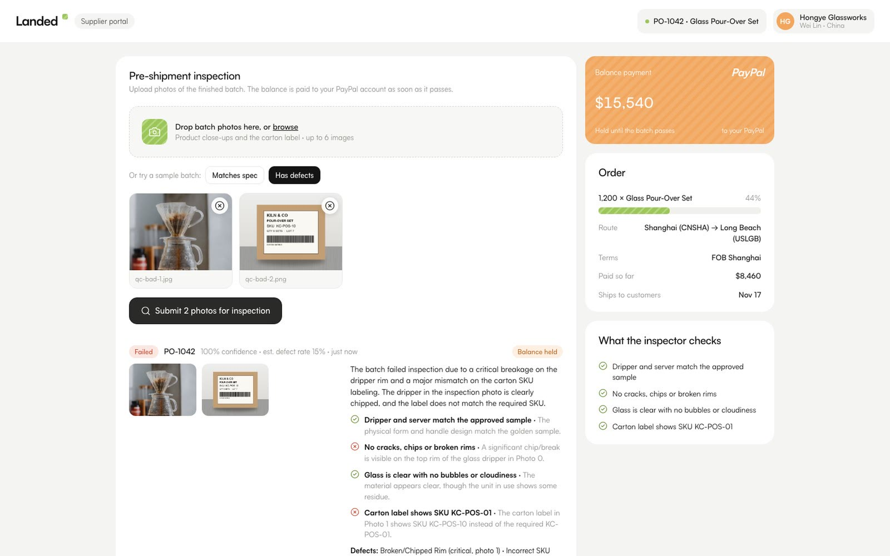

### Ask the plan anything
The Bryntum AI Copilot sits on the timeline. Ask "what if the factory slips 8 more days and we air-freight 120 units?" and it runs the scenario on the live schedule.

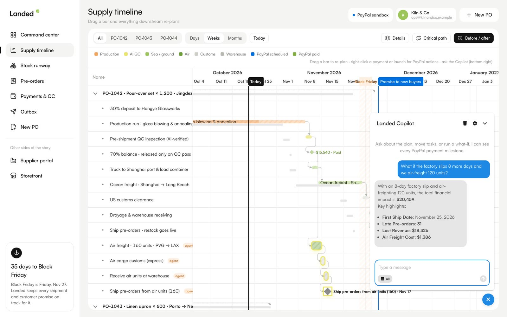

### And the rest of the loop

<table>
  <tr>
    <td width="50%">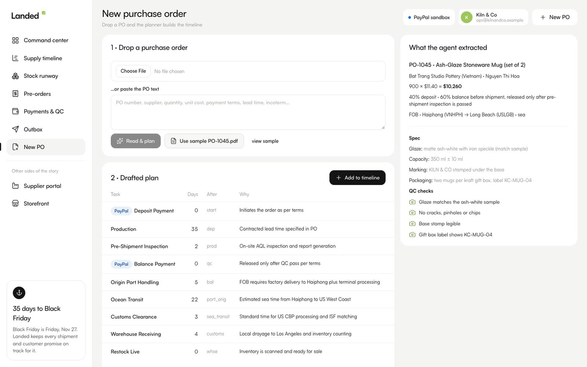<br><b>Drop in a PO.</b> AI reads the PDF, pulls out the terms and drafts the whole plan, with PayPal payment milestones.</td>
    <td width="50%">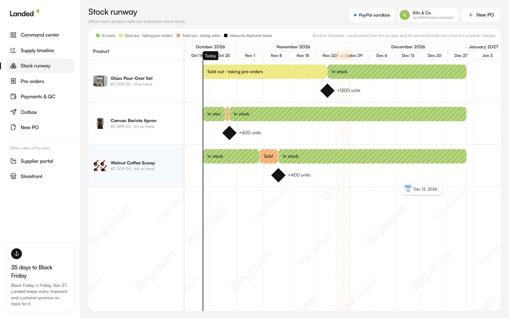<br><b>Stock runway.</b> A Bryntum Scheduler view that shows when each product sells out and when the next batch lands.</td>
  </tr>
  <tr>
    <td>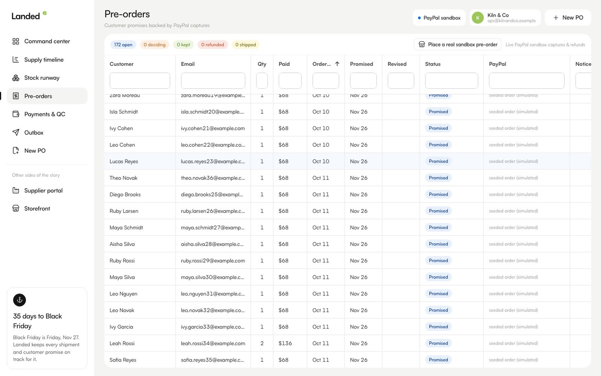<br><b>Pre-orders.</b> Every pre-order and its PayPal capture in a Bryntum Grid, with status, promised date and refunds.</td>
    <td>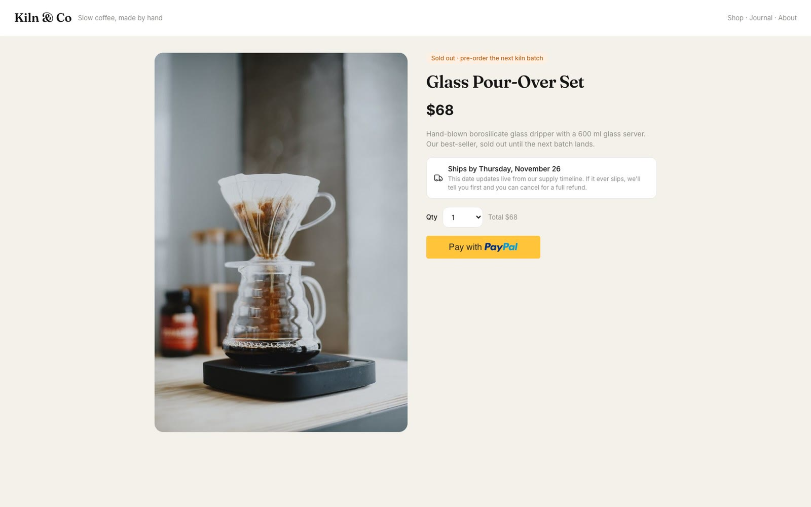<br><b>Honest checkout.</b> The store shows the real ship date from the timeline, with PayPal and Pay Later.</td>
  </tr>
  <tr>
    <td>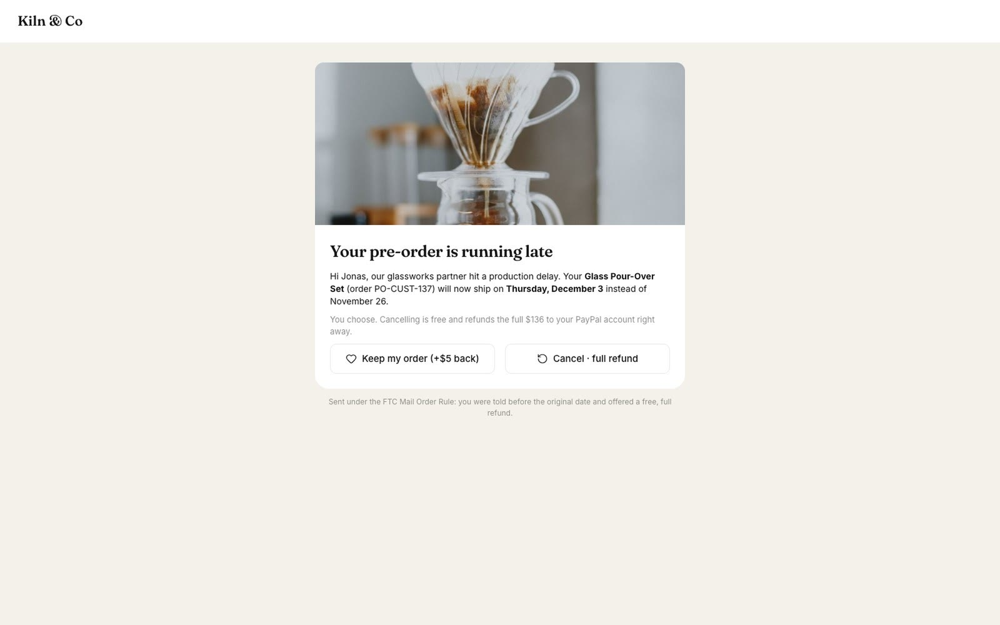<br><b>Customer notice.</b> A clear delay notice with the new date: keep the order or get a full PayPal refund in one click.</td>
    <td>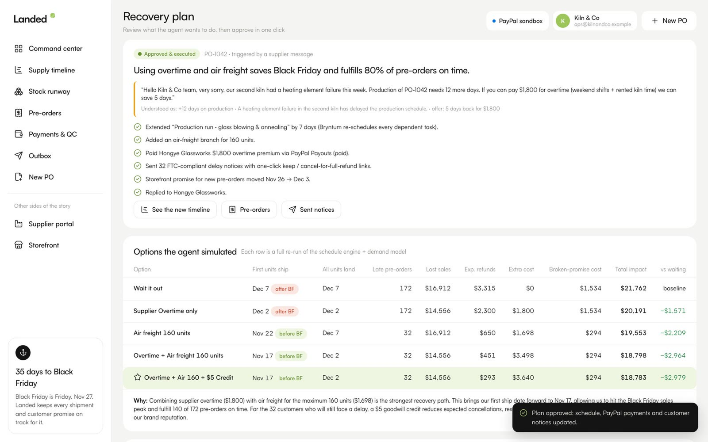<br><b>Full audit trail.</b> Every action the plan took is listed after you approve: schedule, payments and notices.</td>
  </tr>
</table>

## How money moves

All money moves through PayPal, and each payment waits for the event it depends on.

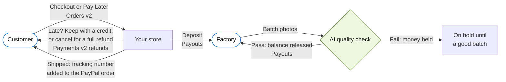

| PayPal API | What Landed uses it for |
|---|---|
| JS SDK v6 | PayPal and Pay Later buttons on the storefront |
| Orders v2 | Creating and capturing pre-orders, and adding tracking when they ship |
| Payments v2 | Full refunds on cancel, and partial refunds as goodwill credits |
| Payouts | Supplier deposits, quality-gated balances, overtime and pay-on-delivery |

## Built on Bryntum

Bryntum is the planning engine behind every screen that shows time.

- **Gantt** is the supply timeline. It loads and saves through Bryntum's CrudManager, so every drag or resize is stored on the server. Landed uses baselines (the grey "before" bars), critical paths, time ranges for Today, Black Friday and the customer promise, labels for PayPal amounts, and a custom task menu to release a payment or mark goods as received.
- **Scheduling engine.** Bryntum schedules the plan in the browser. The server runs a matching forward-pass scheduler with the same rules, so the AI agent can test what-ifs without a browser.
- **AI Copilot** is Bryntum's built-in assistant, connected to Gemini through Landed's server. It has a custom tool, `simulateSupplierDelay`, that calls Landed's simulator, and its task model teaches it what a PayPal payment milestone is.
- **Scheduler** draws the stock runway for each product: in stock, pre-order window, lost-sales window and inbound shipments.
- **Grid** lists every pre-order with filters.

## The AI agents

Landed uses a few small agents, each with one job. The agents read, reason and write. The numbers always come from Landed's own scheduler and demand model, and nothing that moves money or reaches a customer runs without your approval.

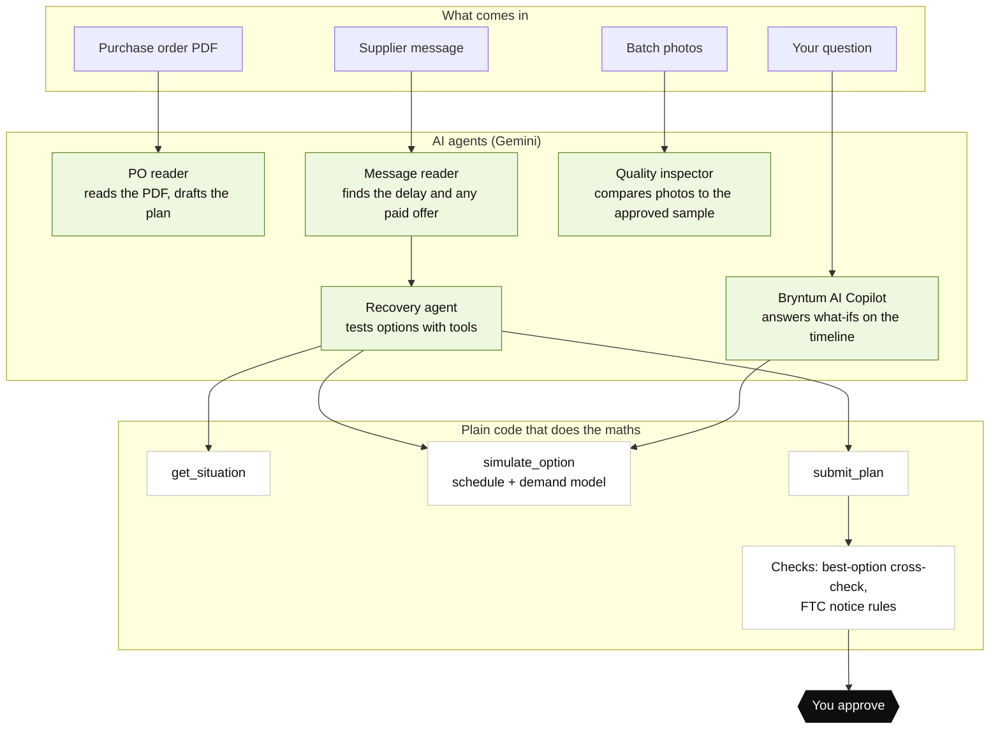

- **The recovery agent** works in a loop. It looks at the situation, simulates as many options as it needs (wait, overtime, air freight in different amounts, a goodwill credit), then submits the one with the lowest total cost. You can watch its reasoning live while it works.
- **Every answer is checked.** A brute-force optimizer runs next to the agent as a sanity check, and customer notices must pass fixed FTC rules before they can be sent.
- **Structured output.** Every agent answers in a strict JSON shape that is validated before Landed uses it.
- **Reliable on a free key.** Calls fall back to other Gemini models when one is busy, and retry with back-off. Claude is supported as an alternative provider.

## Architecture

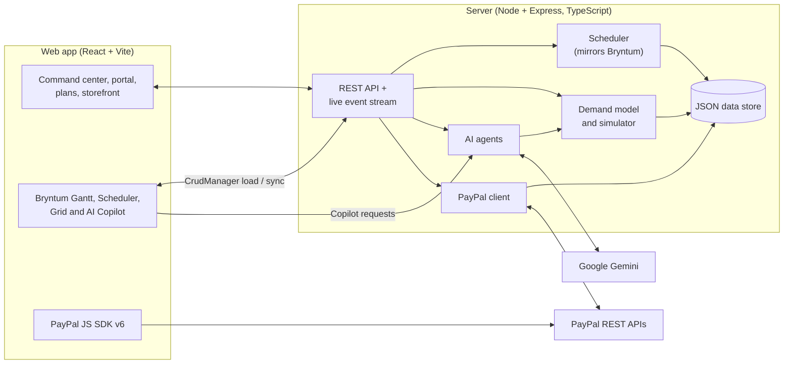

| Layer | Tools |
|---|---|
| Web | React 18, Vite, TypeScript, Bryntum Gantt (with Scheduler, Grid and AI) |
| Server | Node 20, Express 5, Server-Sent Events for live updates |
| AI | Google Gemini via `@google/genai`, Zod for structured output (Claude optional) |
| Payments | PayPal JS SDK v6, Orders v2, Payments v2, Payouts |
| Tests | Vitest for the scheduler, simulator and full approve flow, Playwright for browser runs |

## Run it locally

You need Node 20.19 or newer.

```bash
git clone https://github.com/gylshaurya/landed-supply-chain.git
cd landed-supply-chain
npm install
cp .env.example .env
npm run dev
```

Open http://localhost:5173. The API runs on port 8787.

Landed works without any keys. The agents return recorded answers for the sample data (marked "Demo AI" in the app), and PayPal calls are simulated. Add keys to use the real services:

| Setting | What it turns on |
|---|---|
| `GEMINI_API_KEY` | Live AI agents and the Copilot. A free key from [Google AI Studio](https://aistudio.google.com/apikey) works. |
| `PAYPAL_CLIENT_ID`, `PAYPAL_CLIENT_SECRET` | Real sandbox checkout, refunds and payouts. |
| `PAYPAL_SUPPLIER_EMAIL` | A sandbox personal account that receives supplier payouts. |
| `LANDED_TODAY` | Freezes the app's date so the sample data always lines up. |

Other commands:

```bash
npm test                      # unit and flow tests
npm run build && npm start    # production build on $PORT
```

## Project layout

```
src/                 web app
  pages/             command center, timeline, runway, pre-orders, plans, portal, store
  components/        Bryntum Gantt wrapper, agent console, activity feed
server/
  ai/                Gemini layer, recovery agent, PO reader, quality inspector, Copilot proxy
  schedule.ts        forward-pass scheduler that mirrors Bryntum's engine
  sim.ts             demand model, option simulator and optimizer
  paypal.ts          Orders, refunds, payouts and tracking
  services.ts        what happens when a plan is approved, a batch passes, a customer replies
tests/               scheduler, simulator and end-to-end flow tests
```

## License

MIT
